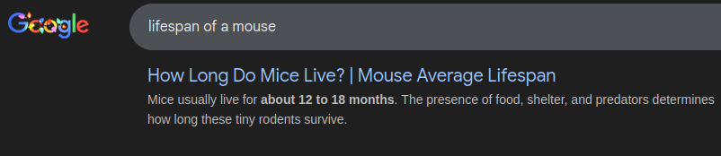
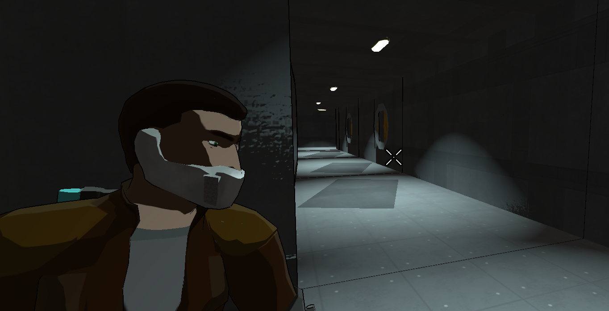
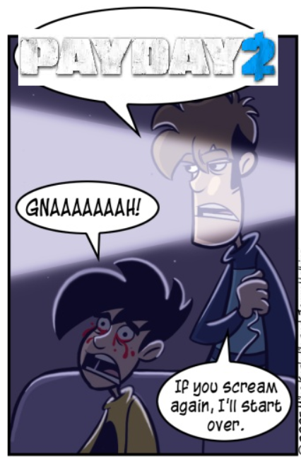
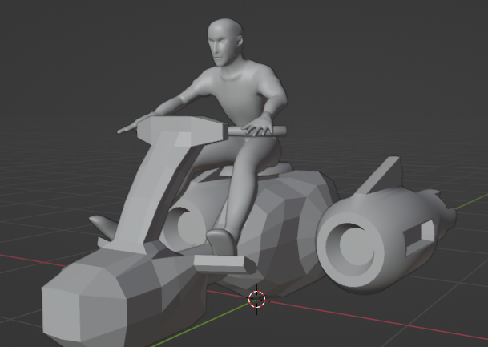
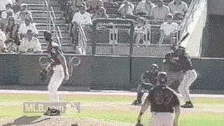
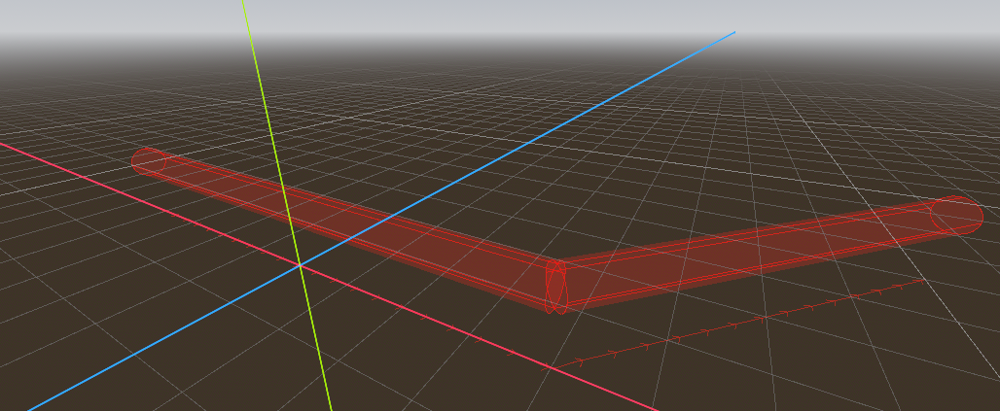
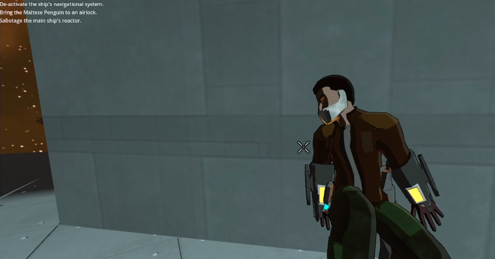

## Rigged: Cover Rails

It has been much time since I have done such as post on this blog; nearing two years, in fact. Mice have been born and died of old age. That time is now *over*, as I once again have something mildly interesting to post in terms of game design.

First, let's get this out of the way: [Extermination Shock launched!](https://store.steampowered.com/app/2510820/Extermination_Shock/) If you have not bought it yet, do so. I am of the *firm* opinion that *everyone* should buy it. And not just 'cause I'm a gross materialist, it really is a pretty good game. The last leg did not involve anything particularly interesting as far as design goes - mostly frantic debugging, Steam headaches, and panicked attempts to market the game. I made my money back as far as commissioning artists go, so I'm happy personally, but for this upcoming one BAEDS Development has decided to think a little bigger.

"Upcoming one?" a wondering audience member says. "Surely, after 18 months of development silence, you've built an entirely new game!" *Fuck you,* audience member! The BAEDS team took a well-deserved break, involving *two* separate trips to the alternate headquarters on a Delaware beach, and is only about most of the way done with our vertical slice on the new game - Rigged.

### What The Hell Is Rigged?

Presumptuous little bastard, aren't you? *Rigged* is the next game from BAEDS Development, using the Godot engine. It is an optionally-multiplayer stealth action shooter in the vein of such classics as Deus Ex, MGSV, and anything that isn't Payday 2, really. We've done a lot of cool work so far! Before I *describe* any of that cool work, though, let me mention first that the BAEDS team deemed my own personal experience with the stealth genre was insufficient, and so made me play a *really good* stealth game (MGSV) followed by a *really bad* stealth game (Payday 2). I don't mind telling you that ten hours of Payday 2 stealth was enough to make me consider suicide and also scrapping the idea of multiplayer stealth entirely, but some friends batted the knife from my arm and then my hands from the "Delete Repository" button. Anyway.

The basic premise of the game is that you, the protagonist, are in debt to the *space Mafia*, and the only way for you to pay off your hideous gambling debt is to *rig* fights in a spaceship dueling tournament. How do you do this, as a hapless engineer? Why, by sneaking aboard and sabotaging it, obviously. Included are randomly-generated spaceship interiors, a cool hacking system that will probably be the subject of a later post, excellent adaptive AI, a space bike, and most recently a cover system.

### Cover System Design

Rigged is intended to be a third-person over the shoulder experience, like Gears of War, Mass Effect, Dead Space, et cetera. Part of this, given that it's a stealth game, is going to involve leaning over and around corners to shoot at enemies, hide from them, diving into lockers to avoid people, all that good stuff. This requires a definition of cover. What *does* that mean?

In this case, the use case is simple; the player shouldn't be spotted from outside cover in the given direction and needs some way to snap to walls appropriately. We nailed down some rules as far as being spotted in cover goes (mainly the details on when the AI is allowed to see you when you're cowering behind a wall), but the real question and reason I'm discussing this is the wall-snapping setup. There are two main approaches to it we considered - a dynamic approach, and a Gears of War style rail approach.

### Dynamic

A dynamic setup here means that anything that looks and quacks like cover is cover; i.e., for high cover you can use while standing it'd be any vertical 1m x 2m area, and for low cover it'd be a 1m x 1m vertical area. This *sounds* simple, but the headache then becomes how you *detect* that cover.

"Surely," my irritatingly technical straw-man asks, "surely you could just have a ray-cast from the player to the wall, and see if it qualified for either definition of cover on a collision?" That was the first crack at this, yeah. If you're not a tech-y type yourself, a **ray cast** is when you draw a line between two points, casting a *ray* into the world. Usually this is done for collision purposes to see if you're about to hit something. Extermination Shock used ray-casts extensively for laser weapons, for example, since that literally is a line getting drawn. A **shape cast** is the same thing, discussed [here](https://wizard-of-chaos.github.io/2023/09/07/obstacle-avoidance.html) in the context of obstacle avoidance for Extermination Shock. In case you're still confused, here's a pigeon getting hit by a shape cast, with the origin point being Randy Johnson.

In this case, we tried out a ray-cast from the player to the wall, and if it existed appropriately, snap the player to it and engage the wall-sliding state. Fine. Sounds good so far. This resulted in the player snapping to a flat wall and schmooving straight *off* said wall. Well, shit. How do we detect the edge of a wall?

More ray-casts? You guessed it. Two more rays thrown out on either side would show us if the wall's about to end, and if so, the player needs to stop in their tracks and isn't allowed to move. That's easy enough, isn't it? Where's the fuss? Aw, hell. When I move on a wall that has a curve to it, the player's just stuck moving in a straight line rather than along the plane of the wall. Shit, how do we detect that? More ray-casts?

You see where this is going. In order to detect stuff properly, we'd need to be constantly checking the player's angle relative to the wall, whether or not the wall curves in the near future, whether or not the wall *ends* instead of curves, and also if the height needs to change for the wall. It's doable, don't get me wrong, but the amount of shape/ray casts we were throwing out for this seemed inelegant and more to the point would start getting expensive eventually when we wanted to smooth the whole thing out. So what's the other option?

### Rails!

As I write this, I find myself on an Amtrak train heading south after the holidays, which is thematically appropriate for the topic. What's *less* appropriate is the fucking guy next to me who seems to think it's kosher to start a *two hour phone call* about the Jets, of all things, on public transit. I fucking hate him, and I want him dead. In this metaphor, you, the reader, are the irritating guy next to me. I think. I dunno, I just wanted to complain. The Jets suck so bad, man.

In any case, the rail I'm on is static; people aren't frantically laying new rails or anything and the train isn't detecting a damn thing. It's just going either forward or backward. This works for our use cases, since in the absence of destructible terrain the walls aren't exactly going anywhere and neither is most of the furniture. We *may* allow the user to blow up crates or something, but removing stuff is easier than creating it.

Gears of War was really good about this - what *it* did was draw some lines around potential cover objects and then allowed the player to *snap* to said lines, engaging with the rail. This allows us to smooth out our own corners, not deal with expensive detection and generate most of the whole thing right when we're building out the rest of the map. Any given cover rail is just gonna be a series of points throughout our generated ship cells and hallways, so we're in good hands. If I want to make a special animation for clambering around a corner, it'll be easy to detect that too based on which two points the rail is between at any given time. Hell, even leaning around a corner is easy; we'll just check for the angle between said points as a stop-point and potential lean location. Easy!

Above is the editor view of a given rail. At the bottom is the path the rail is taking, and up top is just a simple collider the player checks for when aiming at a wall. When you aim at a rail and hit the "take cover" button, you'll snap straight to it and rotate around and start playing the Adam Jensen safety dance animation and all the other crap that comes with cowering behind a box. It's much simpler, pretty easy to set up, and less computationally expensive than the ray-cast solution. The only downside is for a lot of the levels we'll have to go into the cells and drop in cover-points for the path ourselves, but that's a one-time expense. of effort.

### Are There Downsides?

Yeah, plenty. Like I said, this has no options for dynamic setups like, say, a box being tossed around, or even a table (because of course we have physics objects going flying; that's just good fun for space games). I think it *may* be possible to generate some of these on the fly (it'll certainly be possible to remove the ones surrounding a blown-up terminal or what have you), but I think by and large it's just a better idea to say "Tough shit" to the player. Having a predictable environment is important, too. We'll see what our options look like in the future, but for now we're sticking with the Gears of War solution.

### What's Next?

Me beating this fucking pissant next to me to death. Oh, Jesus, he's pulled out a MacBook and started getting ChatGPT to try and help him write his goddamned novel or play or something. I do not miss the future.

As far as the game goes, well, quite a hell of a lot, really. In the future I may get my esteemed colleague to write up something about the random generation for ship interiors (since he's handling that this time around), our musician/audio guy to discuss the setup they're doing (which is also sick as hell) or talk about other stuff we've done so far like the lighting, shaders, hacking system (it's so cool!) or other stuff. More updates to come as we do more and more cool stuff. BAEDS is back in action. I'm going to close my laptop now before I perform a Metal Gear takedown on a train with it.
