# Rigged: PBR Material Design

Visually, Rigged is a lot cooler than Extermination Shock is. That also means it's more demanding in terms of 3D art. One of the things I've been forced to get my shit together with recently is material and texture design, at least to a degree well enough that I can use it as a reference for later. Shaders I've [already discussed](https://wizard-of-chaos.github.io/2023/02/27/shaders.html), and then [followed up on](https://wizard-of-chaos.github.io/2023/06/17/shaders-cont.html) (jeez, those old models look like cave paintings to me now), but texturing large swaths of area is something I've never done.

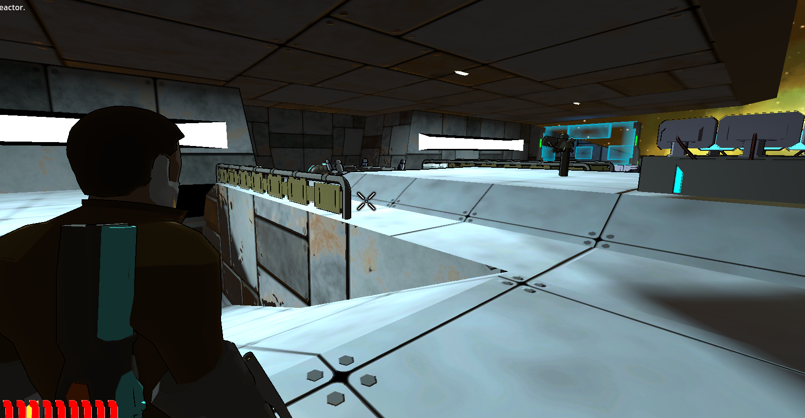

*Until now.* [Behold](https://www.youtube.com/watch?v=FfGZlGsnvDs).

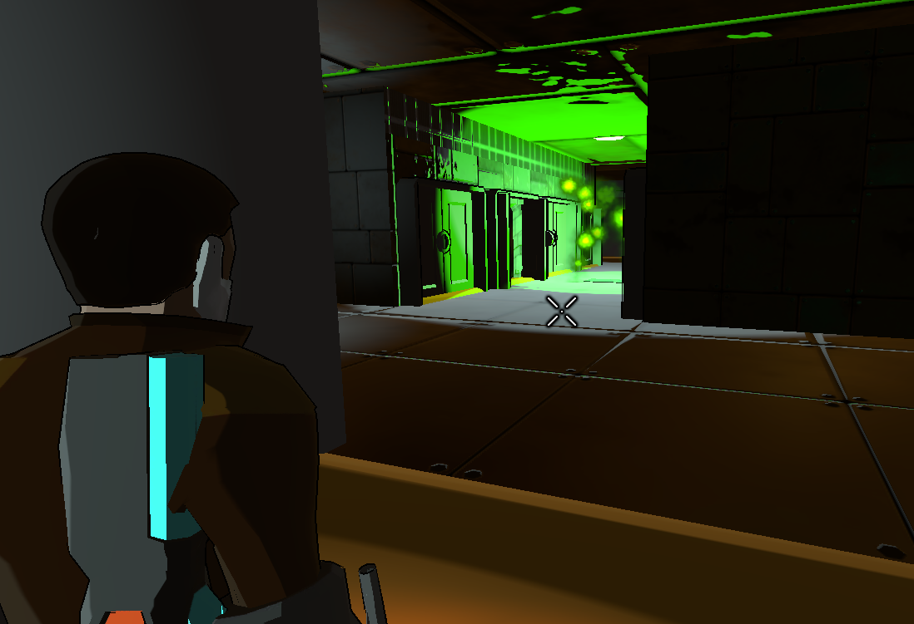

As with everything, present looks are not final, but the important thing to note with pictures like these is that I didn't make an individual texture for every room and wall. That's too much work. Something you need to understand about developers is that we're all lazy assholes. While my character's jacket deserves its own texture, making it for every floor is too much work.

## Reusing Textures: How and Why

Most of you by this point have noticed *before* I brought it up that game developers will re-use textures all over the place, usually for things like floors and walls where there's no meaningful difference between any of your kitchen tiles. If you haven't noticed this, well, I'm sorry for the shocking realization.

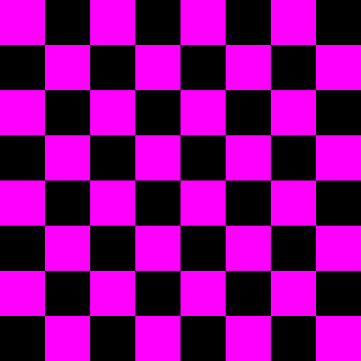

Anyone who's played a custom Valve server has seen this texture at some point. This is an example of a checkerboard pattern that can be infinitely repeated. Valve uses it to signify that whatever texture *should* be applied to the model isn't actually there. Let's take a look at a repeating Valve texture that's *supposed* to be there.

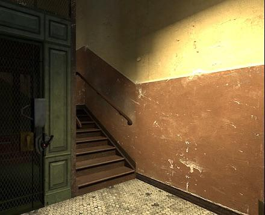

Here's a corridor from Half Life 2. You will note if you look closely that the floor textures have the same stains, repeated over and over, and that wall texture there has the same thing where the various stains and lines on it repeat over and over. This is a massive time saver when you're texturing a lot of environment at once; you'd have to be an actual crazy person to individually texture every surface you see in a game.

For our use case, we're looking for textures that can be infinitely repeated. Say, for metal floor plating, like we've done for Rigged here. What's this called?

## Physically Based Rendering

Ssssorta. What I'm actually talking about is making a *tile*-based material, but we're going to talk about how the sausage gets made first. For Rigged I've been using [Material Maker](https://www.materialmaker.org/) to design stuff like this, so any screenshots are gonna come from that program, but pretty much all material design is going to follow similar principles.

In brief, any texture you see in computer graphics is going to be made up of layers. When I talked about [shaders](https://wizard-of-chaos.github.io/2023/06/17/shaders-cont.html), I noted the concept of a normal map.

>[ Wikipedia describes a normal map](https://en.wikipedia.org/wiki/Normal_mapping) as “a texture mapping technique used for faking the lighting of bumps and dents – an implementation of bump mapping”. That’s correct. We know it is correct because it is on Wikipedia. [...] [Normal] maps are just one of many ways graphical designers try to trick you into seeing more detail than is actually there. 

There's actually quite a lot more that goes into a modern texture than simply determining where the bumps are on the surface. Here's a screenshot of all the outputs from Material Maker:

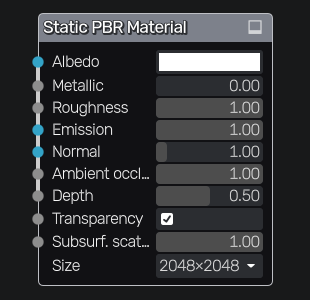

Each little node there is going to be part of our materials output. Let's go through them in order - and we'll take a look at the present tiled material as we do so, which is a fairly simple metal plate texture.

## Albedo

Albedo is the first one, and it's easiest to understand as the *color* of any given material. The technical definition is whatever diffuse light reflects off the material (you'll also hear it referred to as 'diffuse map' or something similar), but for layman's purposes it's the color.

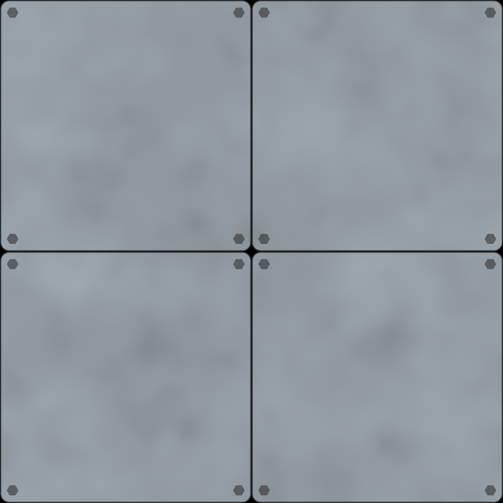

Our color here gives us an idea as to what the rest of the material looks like - we have four plates (that can be repeated infinitely), bolted down, with some mild imperfections in the metal surface. There's a bit of a gap between each plate, which is conveniently how we can get away with making it able to repeat. Simple enough. The basic color is variations on blue-grey, with black for the in-between parts.

I did say it's metal, though, and metal is reflective - or rough sometimes!

## Metallic, Roughness, Ambient Occlusion

These are usually grouped together, because they're all based around the idea of how light is reflected from a surface. Let's explain that briefly. Namely, [specular light](https://en.wikipedia.org/wiki/Specular_highlight). Per Wikipedia:

> A specular highlight is the bright spot of light that appears on shiny objects when illuminated. Specular highlights are important in 3D computer graphics, as they provide a strong visual cue for the shape of an object and its location with respect to light sources in the scene. 

It's the glare coming off your phone at a certain angle, it's the ultra-shiny look of a bald guy with wax on his head, and it's that cool light display you get on a body of water at evening. In order for our material to do stuff like that, we're going to need to put in parameters on how light gets reflected and bounced around.

### A Brief Note Of Complaint

While writing out this post (and in fact while learning how to set all of this up properly), I found a lot of guides on how to do this and very few that actually explained *what it is*. Like, there's a ton of material on how to *make* a metallic map, but not *why* -- people just say "oh, yeah, it controls how metallic it is!" which tells you absolutely nothing and just assumes you know what metal does when struck by light. The moral is never make tools for cargo-cultists. Make everything require a manual.

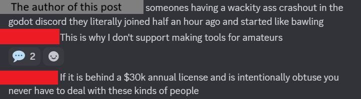

### Metallic

The metallic portion of the texture determines how light mixes with the albedo texture. When a surface is metallic, a part of the light being reflected off of it mixes with the color of the metal itself (in this case, our albedo), so reflected specular light should be partly grey-blue. This is usually handled by a number between 0 to 1, where 0 is "not metallic; mix zero color" and 1 is "completely metallic, mix lots of color".

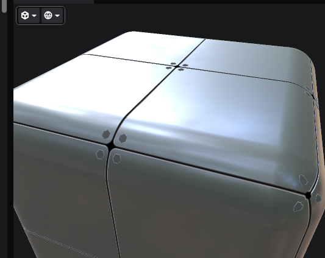

This is a preview from Material Maker on our texture. Note how at the edges of the white light (white being where the light is shining *directly* at an angle to reflect into the camera), it turns bluish-grey -- the same as our albedo above.

Of course, now we should determine whether or not it reflects light *at all* -- some materials don't. My cast-iron pan is pretty dogshit at reflecting light. That's because it has a lot of...

### Roughness

The roughness portion of a texture determines how the same highlights look and whether they appear at all. A very rough surface (like my aforementioned cast-iron pan) might have a very spread-out reflection, but a very smooth surface would reflect the little circle of the sun perfectly. This interacts with the metallic part above, since both deal with reflections. It's also usually handled by a number between 0 and 1, where 0 is "not rough at all, very sharp reflections" and 1 is "extremely rough, very broad and washed out reflections".

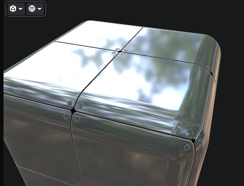

I turned down the roughness on this to exaggerate the effect. Note the much clearer reflections coming off it compared to the previous photo. When turned back up, it looks like the previous photo -- much broader and blended together.

None of this determines whether or not light should get to the texture *at all.* For that we have...

### Ambient Occlusion

Ambient occlusion on a texture determines whether or not light should hit it at all. If I have a deep crack in a surface, light has no business getting down there, and so we should obscure that part of the texture. For this particular surface, I want less light interacting at the edges of the tiles in the little creases between them, so our map has those as dark. This is *also* typically handled by a number between 0 and 1, where 0 is "zero light" and 1 is "full light".

The above three work together to determine how light interacts with a surface, and as I mentioned they are usually grouped together. For the actual *texture*, you can see these as an ORM (Occlusion, Roughness, Metallic) map. Because all of their values can be represented as a number between 0 and 1, we can easily set these as the Red, Green, and Blue values on a texture. Having all 3 as separate grey-scale images is a waste of space. Here's what the ORM map looks like for the tile texture:

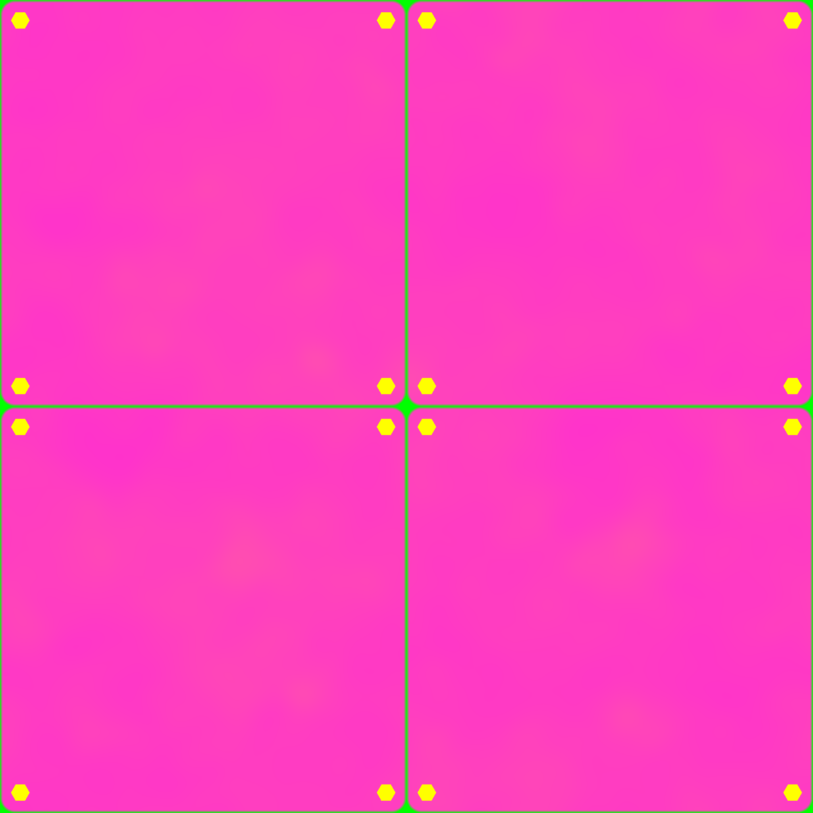

Funky, right? It makes sense when you think about it. Green is dialed all the way up on the cracks, because as I've said, it shouldn't have light on it (0 on the Occlusion value), it's perfectly rough (1 on the Roughness value) and isn't metallic (0 on the Metallic) value. When translated to an RGB color, you wind up with 0/255/0 - perfect green. What the other colors mean I will leave as an exercise for an intelligent reader.

Whew! Hang on, what if the surface *emits* light, instead of just reflecting it?

### Emission

Emission handles the color and strength of light being emitted from the surface, if any. Since my metal plates here don't glow (or at least, they shouldn't), we don't have a texture for emission on this thing, but here's an example from the game.

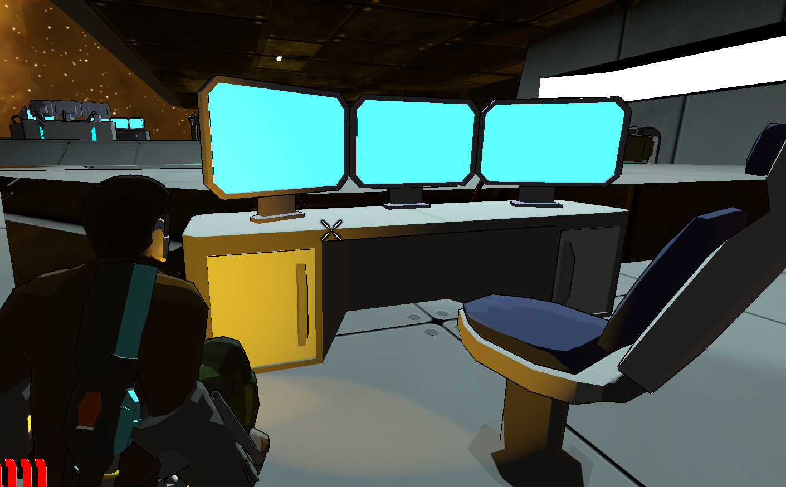

In this case, there are two light sources -- the above light from the ceiling, and the orange light from the character's interface cuffs. The screens here have a high emission value of blue, which means that the light they're giving off is overpowering the other two and as such is not taken into account when determining reflections or other stuff. The albedo on the screen is also blue, which combines to make the screen look like it's glowing blue.

### Normal

Normals I've already talked about above; they determine where the bumps are on a texture by describing the *angle* light should reflect at -- specifically if it's anything other than straight up from a flat surface.

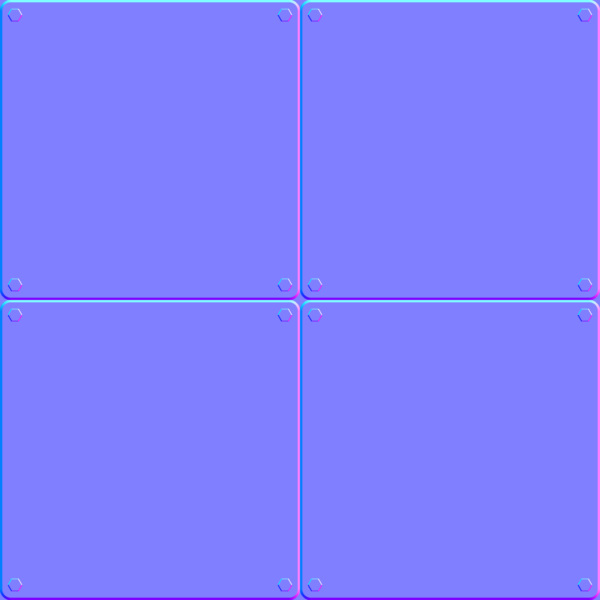

They use the R/G/B color values to describe a [normalized vector](https://en.wikipedia.org/wiki/Normal_(geometry)), or the direction that light should be reflected in for our surface. In this case, I want to fake a little channel between the tiles and I want to fake it so that my bolts on the plates look like they're higher than the rest of it.

### Depth

The depth (or height map) on a texture works similarly to the normal where it determines how high a part of the texture is. I felt it was overkill for the tile texture given the rest of the material, so I didn't use it here, but it's another 0 to 1 value where 0 is "way deep" and 1 is "way high". A black scratch on a white background, for example, would show that the scratch needs to look significantly lower than the rest of the texture and light should interact accordingly.

### Subsurface Scattering

Material Maker includes [subsurface scattering](https://en.wikipedia.org/wiki/Subsurface_scattering), which again I had no use for on this texture given the materials and look I wanted to go for. If you have an object that's partly transparent, this helps determine the angle light should take on its way *out* of the object. The Wikipedia page has a great picture of what this looks like, but you can also think of it as how water warps visuals -- picture how a straw seems to bend when it enters a glass. That's the basic idea.

And that's the basics of a PBR material!

## Putting It Together

Combine all that together in game, and it looks like this:

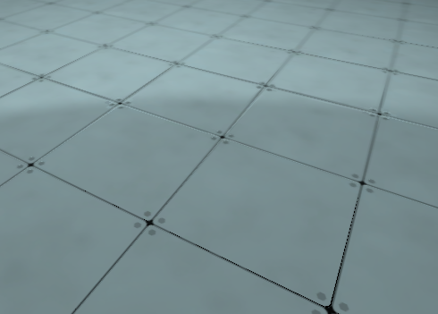

...yep, that's a set of metal tiles, alright. Kind of underwhelming after going through that whole workflow, isn't it?

Thankfully, Material Maker (and Substance Painter, and Blender, and in fact any goddamn workflow that supports this) has a lot of excellent tools to generate these textures, so I don't have to draw all this crap by hand. Hopefully now you understand what exactly goes into making a floor look the way it does in a physically-based rendering pipeline, and can maybe do it yourself if you feel inclined.

## What's Next?

More of this. A lot more of this. Just because I can re-use this material doesn't mean I can reuse it *everywhere*. I need so many more tiles. We also are putting in the grunt work on trying to land a publisher (that sounds so much more refined than "begging executives for money", doesn't it?), which would be super cool if it happens.

There's also some interesting AI work to be done in making it threatening. We did get the multiplayer working as well, but it needs a few tweaks. More as it comes. Whee!