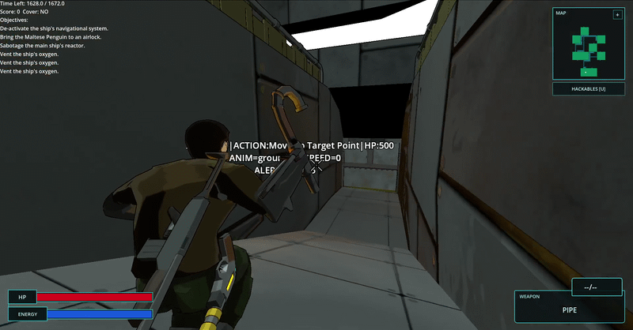
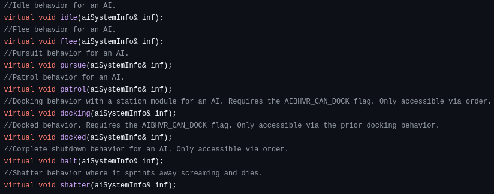
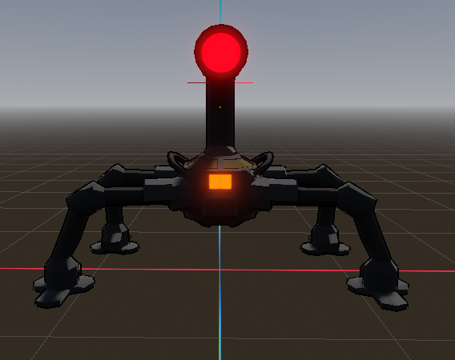
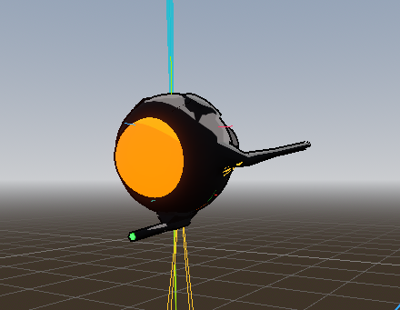
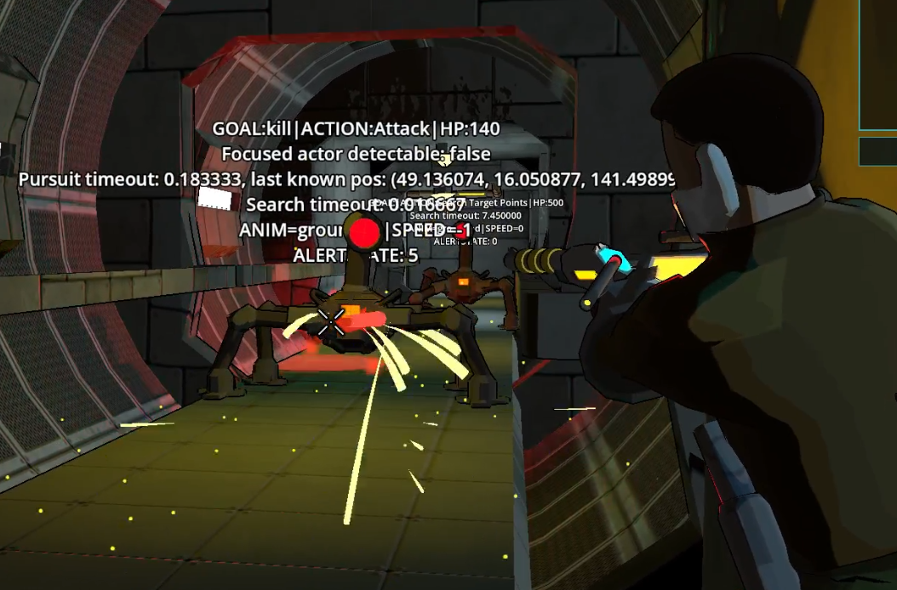
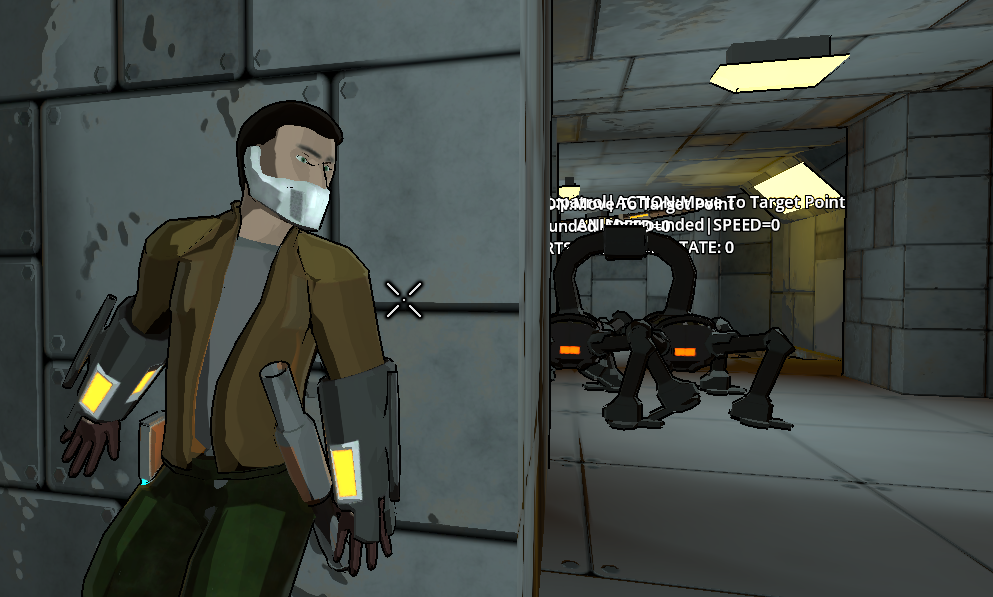
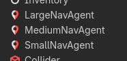
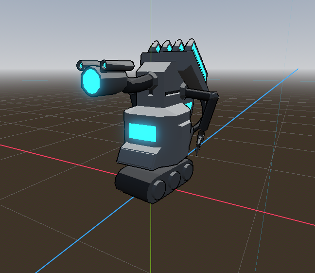

# Rigged: Pathing and AI Design

Level generation is pretty much squared away, but I'm not happy with the hacking system. I mean, I'm happy with the *system* -- it's there, it works, it's pretty cool and very extensible -- but there hasn't been much of a reason to use it, since the AI was pretty basic. It walks at you, it shoots, there's not much to it. There's not even much of a reason to engage with the stealth mechanics we've got so far!

*Until now, that is.* I've spent some time (in between moving and changing jobs and upending my life *outside* of indie development) working on the AI here to get it into a more threatening and stealth-oriented state. Let's go into that. Here's a clip of me getting bowled over by a bot with the new blast effect.

## Goal-Oriented Action Planning (GOAP)

GOAP is one of those things that you've never heard of if you're not in indie spaces, but if you *are* in indie spaces, you've heard way too much about it, kind of like "ECS" or other toys people get very excited about. It's a good fit here, but let me explain by contrast.

Extermination Shock [(yo!)](https://store.steampowered.com/app/2510820/Extermination_Shock/) AI was, at its heart, a [finite state machine](https://en.wikipedia.org/wiki/Finite-state_machine). The classic analogy for what this means is a gear-shift on a car. Your car is in reverse, neutral, first gear, and so on. In order to transition from one to the other, you work the shifter (or just push the gas and brakes, if you're a peasant with an automatic). In the same vein, the AI was either in idle, patrol, attacking and so on, as a *state*. These behaviors got broken down in function, and pursue in particular had a lot of sub-states hidden under the hood (am I running? am I shooting? etc).

GOAP, by contrast, comes at the problem in a way that's a bit more discretized. It starts with a **goal**, pulled from a list of goals available to it, and then based on a list of **actions** available, it creates a **plan** composed of those actions. In this way, you might still has the "pursue" behavior from Extermination Shock, but the goal would be explicitly "Kill Player", and rather than being hidden under the hood mechanically the actions would be "Get behind player", "shoot player", "reload" and so on. This is a bit more work to plan out (the AI needs to have a concept of how each action will lead to the completion of the plan, which is more effort than simply saying "Do X in response to Y"), but allows for some pretty flexible AI design too once you've got the structure. For example, rather than doing customization on the Pursue function and extending it manually, I can drag-and-drop implementations of the Hack action, or some such.

We decided it'd be pretty good for Rigged, given that it's a stealth game with some weird mechanics to it and requires some flexibility.

Security bot here, for example, has two goals: patrol the ship, and kill the player. Kill the player's only valid after he detects you, so most of the time the goal is simply patrol the ship, which is fulfilled by go-to-point actions. Kill the player includes actions such as go to point, aim, and shoot. Both are pretty simple, since the whole purpose of this guy is to pin you down and kill you after being spotted.

The other bot right now is a sensor bot (who I've alternately been referring to as eyebot or tattlebot). Eyebot doesn't have a goal to kill the player; he's got no weapons and nothing to do it with. His goal as a sensor is to report back on the player. To that end, he has four goals available: patrol, report, search and disable.

Eyebot doesn't have any guns, but he *does* have a concussive blast (see above) that'll bowl the player over for a couple of seconds if they get too close. As such, the disable goal kicks in when the player is within a certain range. If that goal's completed (or the player's out of range), he runs off to report the player to the nearest terminal, using similar go-to-point steps and a different set of actions.

The main things here have been expanding on the goals and actions available to the bots. A single enemy that automatically spots you and just runs at you in a straight line isn't very interesting, and if the bots don't have compelling behavior, there's not a hell of a lot of reason to interact with other systems in the game like stealth or hacking! To fix this, the bots now have rules on when they can and cannot see you (actions make noise, you're safe behind a wall, etc) and will now attempt to hunt you down if they lose track of you by searching nearby points and rooms. Our goal here is for straight up engagements to be a gamble. In order to escape, you'll need to either do a takedown, crawl into a vent or barrel, or just hide with some quick thinking. 

## Pathing

In order to do all of this the bots need to walk around the ship as a basic function. Extermination Shock just used forces and vector planning (3D space is like that) rather than explicit pathfinding, but for Rigged it'd be a mistake to operate like that, so we're doing a more traditional [navigation mesh.](https://en.wikipedia.org/wiki/Navigation_mesh) A\*, pathfinding on a plane, the works. A brief summary of this, if you don't know what it means, is just that we draw all over the map as to what areas the AI is allowed to move to, and then they pick out an appropriate route. Worth mentioning is that we have three separate navigation meshes, actually, for small/medium/large AI (a tank, understandably, cannot get to all the same places that an ant could).

The impetus for making this post revolved in getting some updates to pathing done. A hilarious bug we kept having with the bots was as follows:

The bots, in trying to  get from point A to point B, would simply walk straight into each other in confined areas like hallways, because they had no concept that other bots were a thing that exists. It looked funny as hell, but obviously this is suboptimal behavior. So we needed to add a concept of avoidance -- getting out of the way of obstacles and other AI, and so on.

Thankfully, Godot has this [built-in](https://docs.godotengine.org/en/stable/tutorials/navigation/navigation_using_navigationagents.html) because obviously everyone and their dog has done it before and run into this problem. But for us, it wasn't working. It caused extremely erratic behavior -- bots were now walking into walls, running aimlessly in circles, *sometimes* they would play the game correctly but inconsistently... it was a mess. And we were frankly baffled because the only thing we did differently was move some code around.

Eventually, after a full day of frustrated debugging, we pin it down to the fact that there is *something* going wrong with the avoidance mechanism, rather than any of the refactoring we did to accomodate it, so now it came down to an us-versus-library-author question: who's the idiot here? It's typically us, but I wasn't sure, because the avoidance adjustments were just so blatantly incorrect that I couldn't possibly see where it was coming from. In desperation I turn off avoidance entirely for the small/medium/large nav agents, and they're back to pathing correctly, so it wasn't our reorg. It's looking more and more like it's a Godot problem at this point.

I go to turn it back on...

I stop. I squint. And my head slams into my desk as I realize what's been going wrong this whole fucking time. All of these agents were counting *each other* as sources of collision. Because we had all 3 of them with avoidance enabled, they all qualified as an *obstacle to avoid* by the others... which meant that the AIs were just constantly running away *from themselves.* Like a skeleton trying to leap out of its meat suit, they weren't really capable of managing it, leading to the bizarre behavior we were seeing. 

Two changes later and the pathing is fixed. Myself and my co-author were deeply annoyed. At least "The AI was trying to run from itself" is a funny bug to talk about.

## What's Next?

Well, now that the bots are a real threat to deal with and behave correctly, it's time to start testing out our hacking system so we can throw roadblocks at the bots when they come to investigate what you've been doing (or trap them, or kill them, or hack them for yourself). That requires a UI update since hacking specific areas of the map requires a *visual* of what's going on (current minimap doesn't cut it), but it shouldn't be a problem. My esteemed partner is also working on a group lobby where people can run around before missions and equip their armor and weapons and such.

On top of that, we'll be doing more types of bots in the near future to counter player hacks and repair things the player breaks, so that's where our AI system will come in handy. I'll talk about the hacking in more detail another time after we've got our man-in-the-chair gameplay loop set up. Hackbot will be the next stage then.

He's here, and he's a huge goddamn geek, and we'll see him soon. Whee!